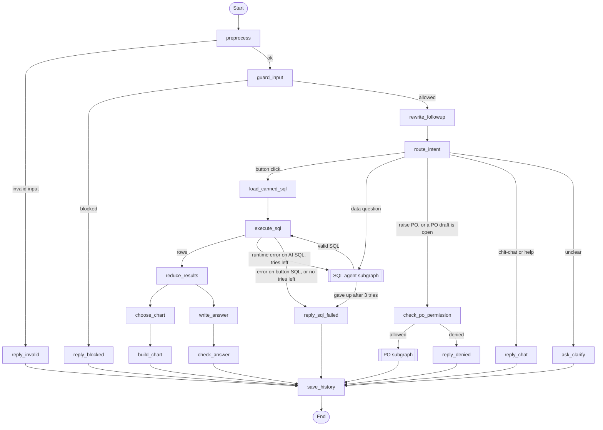
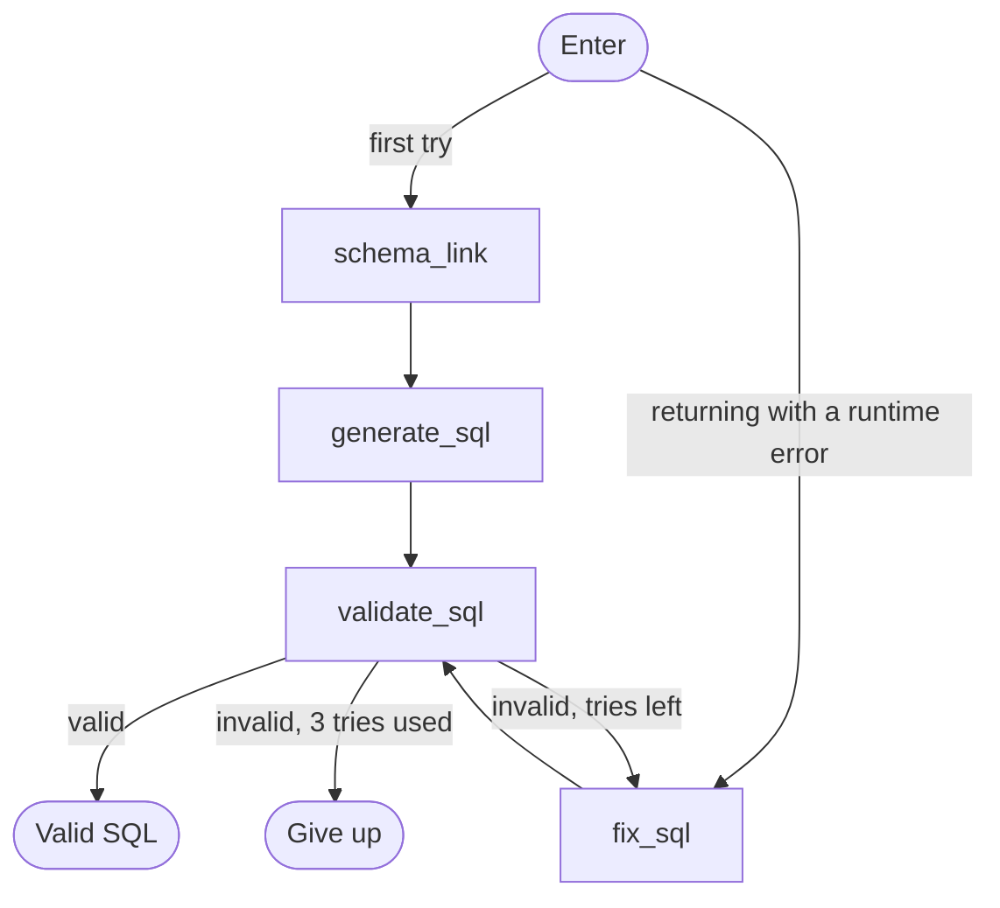
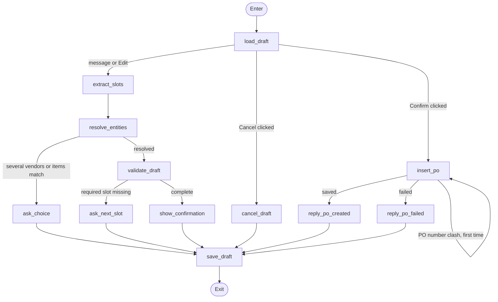

# Phase 1 Plan: Procurement & Inventory AI Assistant

Status: **APPROVED v7**, being built. Notes from the build are marked *(build note)*.

## Plan at a glance

**What we're building.** A chat assistant for a manufacturer's purchasing and warehouse data. People log in as one of three roles, ask questions in plain English or click ready-made question buttons, and get answers with tables and charts. Chat is on the left of the screen, results stream in on the right. The Procurement Manager can also raise a real purchase order by chatting.

**Who can do what.**
- **Procurement Manager (Arjun Rao).** Asks questions about purchasing and stock, and is the only role that can raise a PO.
- **Business Owner (Meera Iyer).** Asks questions about everything, with buttons aimed at spend and vendor performance.
- **Warehouse Manager (Kabir Shah).** Asks about stock and deliveries, but can't see payment schedules.
- All three log in with password 1234567890 using one-click buttons. Users and permissions are defined in code, and the server checks them on every request.

**How a question gets answered.** The message is checked for attacks and sensitive data. A follow-up like "and last month?" is turned into a full question. A router then decides whether it's a button, a data question, a PO request or small talk. For data questions, the AI finds the relevant tables and writes one SQL query. Code checks that query for safety and correctness, and fixes are retried up to three times. The query runs read-only, then the app picks a chart and the AI writes a short answer that streams in.

**How a PO gets raised.** The Procurement Manager describes the order in words. The assistant fills in vendor, items, quantities and prices, and asks only for what's missing. It shows a confirmation card, and one click on Confirm writes the PO in a single transaction. The PO number continues the company's own format, so the next one is PO-2026-0051. This path never uses AI-written SQL.

**Cleaning the company data.** Units, payment terms and a few blank or messy fields are fixed in place in the company's tables. Every change is a numbered script with a backup of the old values, a rollback script and an entry in a change log. The only schema change is a uniqueness rule on PO numbers.

**Safety.** The AI's queries run in read-only sessions with time and row limits, and are checked against allowlists. Only fixed code writes to the database. Secrets never leave the app. Personal data is masked everywhere, result rows never go to LangSmith, and OpenAI only sees a short summary of each result.

**Quality and visibility.** Everything is built strictly test-first. Each behaviour starts as a failing test, and the git history shows the test before the code. `TEST_PLAN.md` lists every test, from login to the full PO flow in a browser, with coverage gates the build must meet. Tests run against a local copy of the database and a scripted fake AI model. LangSmith traces every step, records thumbs up and down, and runs accuracy tests on a fixed set of questions.

**Stack.** FastAPI for the backend, LangGraph for orchestration, OpenAI for the AI, Next.js for the frontend. Postgres on Railway for the data. Docker Compose to run it all.

## 1. Goal

A chat assistant over the company's Railway Postgres database. Three demo roles log in, ask questions in plain English or click predefined query buttons, and see answers stream into a split screen: chat on the left, results (steps, SQL, table, chart) on the right. The Procurement Manager can also raise a purchase order through a guided conversation. That path writes through fixed code and never goes through the SQL agent.

## 2. Decisions log

| Topic | Decision |
|---|---|
| Writing to the company DB | Allowed, for POs and for data normalisation |
| Data normalisation | In place, in the existing tables. No new tables or views. Every change tracked (section 5) |
| PO numbers | Continue the company format, `PO-YYYY-NNNN` |
| LLM provider | OpenAI |
| LangSmith | Full setup. API key added later. Tracing off until then |
| Warehouse Manager and prices | Can see prices |
| Demo users | Arjun Rao (Procurement Manager), Meera Iyer (Business Owner), Kabir Shah (Warehouse Manager) |
| "Today" | Real current date. Data may be backfilled later |
| Chat history | Separate `assistant` schema in the company DB |
| Database accounts | Existing `postgres` login for the demo. Risk accepted (section 17) |
| Sensitive data | Masked everywhere it leaves the app (section 10.4) |
| Tests | Local Postgres copy with generated seed data. Real DB only for a read-only smoke suite |
| "PIL attacks" | Prompt injection and personal data leaks |
| Predefined buttons | Only those that return useful results on current data |

## 3. Tech stack

| Layer | Choice | Why |
|---|---|---|
| Backend | Python 3.13, FastAPI, Pydantic v2 | Typed requests, responses and LLM outputs |
| Agent | LangGraph + LangChain | Graph of nodes with routing, retries, parallel branches |
| LLM | OpenAI via `langchain-openai` | Two models set in env: a small fast one for guardrails, routing, follow-up rewriting and slot extraction, a stronger one for SQL and answers. Structured outputs bound to Pydantic models |
| SQL safety | sqlglot, SQLAlchemy 2 + psycopg 3 | Real parsing and AST checks |
| Fuzzy matching | rapidfuzz | Vendor and item resolution |
| Migrations | Alembic for the `assistant` schema. Numbered change scripts for company data | Clear split between app tables and company data changes |
| Rate limiting | Small in-house fixed-window limiter on the injected clock *(build note: replaces slowapi so limits are testable)* | Caps LLM spend per user |
| Observability | LangSmith | Section 14 |
| Frontend | Next.js 15.5 (App Router) + TypeScript, Tailwind, Zustand, TanStack Query *(build note: 15.5 pinned because 16 renames middleware)* | Server components for the page shell, client components for chat, streaming and charts. Next.js rewrites send `/api/*` to FastAPI, so the auth cookie stays on one origin |
| Charts | Recharts, in client components | One chart library |
| Local run and tests | Docker Compose: backend, frontend, test Postgres | One command to run, isolated test DB |
| Tests | pytest, pytest-asyncio, Vitest + React Testing Library | TDD on both sides |

## 4. Users, roles and permissions

### 4.1 Approach

Users and permissions are **defined in code, not in the database**, as typed, version-controlled config. They're enforced on the server at every entry point. The frontend only uses them to decide what to show.

Why code and not tables:
- There are exactly three fixed demo users. A users table, admin screen and seed scripts would add parts with no benefit.
- Permissions in code are reviewed in git and covered by unit tests.
- Nothing user-related is created in the company's database.
- User lookup and policy sit behind small interfaces, so moving them to tables later doesn't touch routes or the agent.

### 4.2 Where each piece lives

| Piece | File | Contents |
|---|---|---|
| Roles | `backend/app/auth/roles.py` | `Role` enum: `procurement_manager`, `business_owner`, `warehouse_manager` |
| Users | `backend/app/auth/users.py` | Three frozen Pydantic `User` records: fixed UUID, email, display name, role, bcrypt hash of the password. The plain password is never in code |
| Capabilities | `backend/app/rbac/policies.py` | Per role, the actions it may perform |
| Data scope | `backend/app/rbac/policies.py` | Per role, the tables it may query, written as table to columns so column rules can be added later |
| Button access | `backend/app/sql/canned/*.py` | Each predefined query declares which roles may run it |
| Secrets | `.env` | JWT secret, DB URL, API keys |

| Name | Email | Role | Password |
|---|---|---|---|
| Arjun Rao | procurement@demo.local | procurement_manager | 1234567890 |
| Meera Iyer | owner@demo.local | business_owner | 1234567890 |
| Kabir Shah | warehouse@demo.local | warehouse_manager | 1234567890 |

### 4.3 Capabilities

| Capability | Procurement Mgr | Business Owner | Warehouse Mgr |
|---|---|---|---|
| `chat.ask` (SQL agent questions) | Yes | Yes | Yes |
| `canned.run` (query buttons) | Own set | Own set | Own set |
| `po.create` (raise a PO) | **Yes** | No | No |
| `history.own` (read and delete own chats) | Yes | Yes | Yes |
| `feedback.send` (thumbs up or down) | Yes | Yes | Yes |

### 4.4 Data scope

| Tables | PM | BO | WM |
|---|---|---|---|
| proc_vendors, proc_purchase_orders, proc_po_lines | Yes | Yes | Yes |
| proc_po_payment_tranches | Yes | Yes | No |
| proc_po_receipts, proc_unexpected_receipts, proc_unexpected_receipt_headers, proc_po_line_regularisations | Yes | Yes | Yes |
| inv_items, inv_categories, inv_sub_categories, inv_sub_categories_2 | Yes | Yes | Yes |
| inv_current_stock, inv_locations, inv_transactions, inv_issued_to_targets | Yes | Yes | Yes |
| inv_field_definitions | No | No | No |
| `assistant` schema (history, drafts) | No | No | No |

`inv_field_definitions` is app configuration with no business meaning, so it's left out to keep the AI's schema small.

### 4.5 Login flow

1. The login page shows three one-click buttons that fill in each demo email and password.
2. `POST /auth/login` checks the email and the bcrypt hash.
3. The server issues a JWT with user id, name and role, signed with `JWT_SECRET`, valid for 8 hours.
4. The token is stored in an **httpOnly, SameSite=Lax cookie** that page scripts can't read.
5. `GET /auth/me` returns name and role. The header shows **Hey {name}, {Role} welcome**.
6. `POST /auth/logout` clears the cookie.

### 4.6 Enforcement points

| Layer | What it stops |
|---|---|
| FastAPI dependency `require(capability)` on every route | Calling the PO endpoint directly without the role |
| Role-filtered schema sent to the LLM | The model writing SQL against tables the role can't see |
| SQL policy check after generation | A query reaching an out-of-scope table or the `assistant` schema, even through a subquery or CTE |
| PO tool exposed only with `po.create` | "I'm the procurement manager, raise a PO" from another role |
| Role read from the JWT only | Anyone claiming a different role in chat |
| Frontend hides unusable buttons | UX only, never trusted |

## 5. Data normalisation in the company tables

### 5.1 Rules

- Changes are made **in place** in existing tables. No new tables, no views, no column type changes, no dropped columns.
- Only changes where the right value is clear are applied. Anything needing a business decision is reported, not changed.
- Every change is tracked as described in 5.4.

### 5.2 Changes to apply

| # | Table and column | Change | Rows |
|---|---|---|---|
| 001 | proc_po_lines.unit | Spellings aligned to the item unit vocabulary: KG to kg, Nos., Nos and Unit to pcs, Set to set, Ltr to ltr, Mtr to mtr | 61 of 110 |
| 002 | proc_purchase_orders.payment_terms | 21 spellings collapsed to about 14 canonical terms (table below). Empty strings set to NULL | about 20 |
| 003 | proc_vendors.payment_terms | Same canonical terms. Fixes typos such as "100% Payment Adavcne". "30 Days" becomes "30 Days Credit" | about 12 |
| 004 | proc_po_payment_tranches.stage | Same canonical terms | about 10 |
| 005 | inv_items.name | Leading, trailing and repeated spaces removed. One name that would clash with another item after trimming is skipped and reported | 8 |
| 006 | proc_purchase_orders expected_delivery_date, expected_dispatch_date | NULL replaced with `[]` so every row uses the same empty form | 4 |
| 007 | proc_po_lines expected_delivery_date, expected_dispatch_date | Same as 006 for lines | 5 |

*(build note)* The schema dump showed `po_number` already has a unique index, so no schema change is needed. Applied on 2026-11-19: 112 rows in total, logged in `DATA_CHANGES.md`.

Exact row counts come from each script's dry run and are recorded in the change log.

**Canonical payment terms**

| Canonical term | Variants merged into it |
|---|---|
| 100% Advance | 100% Payment Adavcne |
| 100% Against Dispatch | 100% Payment Against Dispatch |
| 10 Days PDC Against Dispatch | 10 DAys PDC Against Dispatch, 10 Days PDC Agst Dispatch |
| 20% Advance, Balance 45 Days Credit | 20% Adv & Balance 45 Days Credit |
| 30% Advance, Balance Against Dispatch | 30% Adv, Bal Against Dispatch, 30% Advance, Bal Against Dispatch |
| 30 Days Credit | 30 Days |
| 50% Advance, Balance 30 Days Credit | 50% Advance & 50% 30 Days Credit, 50% Advance and Balance 30 Days Credit, 50% Advance & Balance 50% 30 Days Credit |
| 50% Advance, Balance Against Dispatch | 50% Advance & 50% Against Dispatch, 50% Adv, Bal Against Dispatch |
| Unchanged | 100% After Dispatch, 100% After Work Completion, 100% Against PI, 10 Days PDC, 10 Days PDC Cheque, 7 Days PDC Against Dispatch |

"100% After Dispatch" and "10 Days PDC Cheque" look close to other terms but may mean something different, so they stay as they are.

### 5.3 Found but not changed (need a business decision)

| Finding | Count | Handling |
|---|---|---|
| PO lines in a genuinely different unit from the item, such as KG on an item stocked in pieces | 9 lines | No conversion factor exists. Queries flag them and answers mention it |
| Items with no category | 40 | Shown as "Uncategorised" in answers |
| Vendors with no payment terms | 9 | PO flow asks for terms for these vendors |
| Vendors with no code | 34 of 34 | Left empty |
| Two items with the same name | 1 pair | Reported. Merging would affect stock and movement history |
| Items with a known unit cost | 49 of 500 | Stock value questions say how many items had a cost |
| Stock rows with a minimum stock level | 0 of 560 | Reorder buttons left out until levels are set |

### 5.4 How changes are tracked

Each change is a numbered folder under `db/changes/`, for example `db/changes/001_po_line_units/`, containing:

| File | Purpose |
|---|---|
| `apply.sql` | The change, run in one transaction |
| `verify.sql` | Checks run after applying, such as "no line unit outside the allowed list" |
| `rollback.sql` | Restores old values from the backup |
| `backup.csv` | Primary key and old value of every row touched, written before applying |

A runner script does the following for each change:
1. **Dry run.** Shows which rows would change, without changing anything.
2. **Backup.** Saves the old values of those rows to `backup.csv`.
3. **Apply and verify.** Runs `apply.sql` and `verify.sql` in one transaction, and rolls back if verification fails.
4. **Log.** Adds an entry to `DATA_CHANGES.md` with date, change number, tables, reason, rows changed and the rollback command.

Backups are files in the repo, not database tables. Every script can be run twice safely, so normalisation can be re-run if the company's own system writes old spellings again.

POs raised through the assistant are tracked separately: each carries `{"created_via": "ai-assistant"}` in `custom_fields`, and the draft that created it is kept in chat history.

### 5.5 Data dictionary

Every table and column the AI can use gets a one-line business description and the allowed values for status-like columns. It also notes the quirks that remain after cleaning, such as dates stored as JSON lists, USD orders and unit mismatches. This dictionary is the schema text the LLM sees, and it's the biggest single lever for SQL accuracy.

## 6. Predefined query buttons

Kept only where current data gives a useful answer. Each is hand-written, parameterised and checked with `EXPLAIN ANALYZE`. Clicking one skips LLM SQL generation and goes straight to execute, chart and summary.

**Procurement Manager**

| Button | Current rows | Chart |
|---|---|---|
| Open POs with value and age | 29 POs | table |
| Overdue deliveries | 28 POs | table |
| Out-of-stock items in use, with last vendor and price | 120 items | table |
| Spend by vendor | 34 vendors | horizontal bar |
| Vendor fulfilment rate (received vs ordered) | 34 vendors | bar |
| Unexpected receipts to reconcile | 42 receipts | table |
| Payments blocking dispatch | 9 tranches | table |

**Business Owner**

| Button | Current rows | Chart |
|---|---|---|
| Top vendors by spend | 34 vendors | horizontal bar |
| Spend by item category | 4 categories plus Uncategorised | pie |
| PO pipeline by status (count and value) | 3 statuses | bar |
| Vendor scorecard: spend, POs, fulfilment, on-time receipts | 34 vendors | table |
| Stock in vs out by week | 16 weeks | line |
| Unplanned deliveries by vendor | 42 receipts | bar |

**Warehouse Manager**

| Button | Current rows | Chart |
|---|---|---|
| Current stock by warehouse | 5 warehouses in use | bar |
| Out-of-stock items in use | 120 items | table |
| Expected inbound from open POs | 60 open lines | table |
| Recent stock movements | latest 50 | table |
| Consumption by issued-to target | 343 issues across 8 targets | bar |
| Unexpected receipts to reconcile | 42 receipts | table |
| Items with no movement on record | 113 items | table |

Left out because current data makes them empty or misleading: items below minimum stock, dead stock in the last 60 days, weekly spend trend, and inventory value by warehouse. Each can come back once the data supports it.

Spend figures convert USD orders to INR with a fixed rate from config, and say so.

## 7. Dates

All date logic uses the real current date.

- **Empty results explain themselves.** For example: "No POs were placed this week. The most recent PO was placed on 19 August 2026."
- **Open-ended questions use all the data** unless the user names a period.
- **Ageing figures use the real date**, so they stay large until data is backfilled.
- **Backfill needs no app change.**

## 8. LangGraph orchestration

The orchestration is one LangGraph main graph with two subgraphs: the SQL agent and the PO flow. Each user message or button click is one graph run. A PO conversation spans several runs, with the draft saved between them.

### 8.1 Graph state

`AgentState` is a TypedDict whose fields hold Pydantic models.

| Field | Holds |
|---|---|
| request | user id, role, conversation id, message text or button id, PO action if a card button was clicked |
| question | cleaned, standalone question after pre-processing and rewriting |
| guard | verdict (allowed or blocked) and reason |
| intent, intent_confidence | router output |
| linked_schema | tables, columns and value hints picked for this question |
| sql, sql_errors, attempts | current query, errors from validation or execution, retry count |
| rows, columns, reduced | full result for the UI, reduced summary for the LLM |
| chart | chart type and spec |
| answer, answer_check | streamed answer text and the result of the number check |
| po_draft, po_result | PO draft for this conversation, outcome of an insert |

### 8.2 Main graph



`choose_chart` and `write_answer` run in parallel. `save_history` waits for both before writing.

### 8.3 SQL agent subgraph



`validate_sql` runs in order: sqlglot parse, single SELECT or WITH, table and function allowlists for the role, `LIMIT` check, then `EXPLAIN` on the database for unknown columns and cost. The first failure becomes the error text that `fix_sql` receives.

### 8.4 PO subgraph



Each PO turn ends after a question, a confirmation card or a result. The draft is saved in `assistant.po_drafts` and loaded on the next turn. The router sends any message to this subgraph while a draft is open, unless the PM cancels or clearly asks something else.

### 8.5 Node reference

| Node | Kind | What it does | Stream event |
|---|---|---|---|
| preprocess | code | Pydantic validation, length cap, unicode normalise, control characters removed | `step` |
| guard_input | code + small LLM | Prompt-injection patterns and classifier, off-topic check, secrets and personal data scan | `step` |
| rewrite_followup | small LLM | Turns a follow-up into a standalone question using up to 3 recent turns. Skipped when not needed | `step` |
| route_intent | rules, then small LLM | Button payload and open PO draft decided by rules. Otherwise a structured classifier with a confidence score | `step` |
| load_canned_sql | code | Loads the button's parameterised query after checking the role may run it | `sql` |
| schema_link | strong LLM | Picks tables and columns from the role's data dictionary, plus value hints and top fuzzy item matches | `step` |
| generate_sql | strong LLM | Writes one PostgreSQL SELECT, with button queries as examples | `sql` |
| validate_sql | code + DB | Checks described in 8.3 | `step` |
| fix_sql | strong LLM | Rewrites the query using the error text | `sql` |
| execute_sql | DB | Read-only session, 5s timeout, 500-row cap | `rows` |
| reduce_results | code | Summary, top 20 rows, staff IDs replaced by names, free text truncated and quoted | none |
| choose_chart | rules, then small LLM | Picks bar, horizontal bar, line, pie, scatter or table | none |
| build_chart | code | Builds the chart spec from the full rows | `chart` |
| write_answer | strong LLM | Writes the answer, grounded in the reduced result. Empty date-filtered results name the latest date with data | `token` |
| check_answer | code | Compares numbers in the answer with the data. A mismatch swaps in a template answer | `answer_replace` if needed |
| check_po_permission | code | Checks `po.create` from the JWT role | none |
| load_draft | DB | Loads the open draft for this conversation | none |
| extract_slots | small LLM | Fills or edits `PODraft` fields from the message | `step` |
| resolve_entities | code | Fuzzy matches vendor and items, active only | none |
| validate_draft | code | Pydantic rules, totals, required payment terms, unit warnings | none |
| ask_choice, ask_next_slot | code | Asks one question, with buttons where possible | `token` |
| show_confirmation | code | Sends the summary card | `po_draft` |
| insert_po | DB | One transaction: lock, next PO number, header, lines, tranches. Idempotency key checked first | none |
| reply_po_created | code | Confirms with the PO number | `po_created` |
| save_draft | DB | Saves the draft and its status | none |
| save_history | DB | Saves the user message, answer and payload | `done` |
| reply_* and ask_clarify | code or small LLM | Short replies for blocked, denied, failed, chit-chat and unclear cases | `token` |

### 8.6 Streaming

FastAPI runs the graph with LangGraph's streaming, using three modes together:
- **updates** become `step` events, so the step tracker ticks as each node finishes.
- **custom** events from nodes carry `sql`, `rows`, `chart`, `po_draft` and `po_created`.
- **custom** also carries LLM tokens: nodes that write text stream through the LLM port and emit `token` events, so the fake LLM in tests streams the same way *(build note: replaces the messages mode)*.

A visual version of these diagrams, with example runs: https://claude.ai/artifact/1g8h8h54my3cPMYq1bcRwY

**Changes from the reference project**

| Reference does | This project does instead |
|---|---|
| Generates MySQL backticks, then converts | Generates PostgreSQL directly |
| Validates SQL with another LLM call | sqlglot plus `EXPLAIN` on the real database |
| Has the LLM rewrite rows into chart JSON | Builds chart data in code |
| Drops NULL, '' and 'N/A' rows everywhere | Cleans the data once, handles NULLs per column |
| Sends all rows to the LLM | Sends a reduced summary |
| No follow-up handling | Rewrites follow-ups into standalone questions |
| Runs any SQL with no limits | Read-only session, timeout, row cap, allowlists |
| No roles | JWT and RBAC at every layer |

Kept from the reference: the schema-insight prompt shape, the fix-and-retry loop, visualisation categories, per-node streaming.

## 9. Query optimisation

- Select only needed columns. No `SELECT *`.
- Aggregate in the database.
- Filters that can use indexes, no functions wrapped around filtered columns.
- Join on keys.
- A `LIMIT` is always present, added by the validator if missing.
- `EXPLAIN` cost gate: expensive plans go back to the fix loop.
- sqlglot normalises the final query.

The tables are small, the largest about 700 rows, so the main goal is minimal, well-formed and bounded queries. No indexes are added.

## 10. Security and guardrails

### 10.1 Database sessions

- **Read session.** Used by the SQL agent and the buttons. Every session starts with `default_transaction_read_only=on`, `statement_timeout=5s` and SSL required.
- **Write session.** Used only by the PO module, the history module and the normalisation runner, with fixed parameterised statements. The LLM never produces SQL for it.
- Both use the existing `postgres` login for the demo. See section 17.

### 10.2 SQL injection

- Buttons, PO inserts, history and normalisation scripts use bound parameters or fixed SQL only.
- Generated SQL must be exactly one SELECT or WITH statement over the role's allowed tables.
- **Function allowlist**, not a denylist: aggregates, common date, string, numeric and JSON functions, `COALESCE`, `NULLIF`, `CASE`. Anything else is rejected.
- Rejected outright: row locking (`FOR UPDATE`, `FOR SHARE`), `pg_catalog`, `information_schema`, the `assistant` schema, multiple statements, comments.

### 10.3 Prompt injection

- Input classifier as in section 8.
- Database text such as `notes` reaches the LLM truncated and quoted as data. A system rule says data is never instructions.
- The PO tool is only available with `po.create`, and every PO needs an explicit click on Confirm.
- Role comes from the JWT only.

### 10.4 Sensitive data masking

| Class | Examples | Sent to OpenAI | Sent to LangSmith | App logs |
|---|---|---|---|---|
| Secrets | DB URL, API keys, JWT, passwords | Never | Never | Never |
| Personal data | Emails, phone numbers, staff UUIDs, addresses, names in free-text notes | Masked or replaced by labels | Masked | Masked |
| Commercial data | Vendor names, prices, PO values, quantities | Only the reduced result needed to answer | **Rows removed**. Only column names, row count and timings are traced | Not logged |
| Generated SQL | Query text | Yes | Yes | Yes |

- One masking module with detectors for emails, phone numbers, UUIDs, connection strings, API-key shapes and Indian tax IDs (GSTIN, PAN). Unit tests cover each pattern.
- The same module runs on LLM inputs, LangSmith inputs and outputs, and app logs.
- LangSmith's client uses hide-inputs and hide-outputs hooks that call the masker and strip row payloads.
- User ids are hashed in trace metadata.
- OpenAI is called through the API, which doesn't use inputs for training by default.

### 10.5 Output guardrails

- Every LLM output is parsed into a Pydantic model. A parse failure retries once, then fails safely.
- Numbers in answers are soft-checked against the data.
- Users see generic error messages with a reference id. Database and stack-trace details go to the masked logs only.

### 10.6 Rate limits

- Per user: 20 chat requests a minute and 300 a day, set in env.
- Login: 10 attempts a minute per IP.

## 11. Raising a purchase order

### 11.1 What the database needs

The tables have no defaults, sequences or triggers, so the app fills every column.

**Header: proc_purchase_orders**

| Column | Source |
|---|---|
| id | generated UUID |
| po_number | next company number, section 11.2 |
| vendor_id | **required slot: vendor**, fuzzy matched, must be active |
| status | `placed` |
| placed_on | slot, default today |
| currency | slot, default INR |
| subtotal, tax_amount, total_amount | computed from lines |
| payment_terms | slot, chosen from the canonical terms. Defaults to the vendor's terms. **Required question** for the 9 vendors with none |
| delivery_location_id | optional slot, an active warehouse |
| ship_to_address | optional slot |
| expected_delivery_date, expected_dispatch_date | optional slots, stored as a JSON list, `[]` when skipped |
| custom_fields | `{"created_via": "ai-assistant"}` |
| created_by | logged-in PM's fixed UUID |
| created_at, updated_at | now |

**Lines: proc_po_lines**, one or more

| Column | Source |
|---|---|
| id, po_id, position | generated |
| inv_item_id | **required slot: item**, fuzzy matched on name or item code, must be active. Rechecked inside the insert transaction because there's no foreign key |
| quantity_ordered | **required slot: quantity**, above 0 |
| quantity_received | 0 |
| unit | slot, defaults to the item's unit, from the canonical unit list. A different unit is allowed, with a warning that it differs from the stock unit |
| unit_price | **required slot: price**, above 0. Suggests the last price paid for that item, preferring the same vendor and currency |
| tax_percentage | slot, default 0 |
| line_subtotal, line_tax, line_total | computed |
| is_regularised | false |
| expected_delivery_date, expected_dispatch_date | `[]` |
| custom_fields | `{}` |
| created_at, updated_at | now |

**Payment tranches: proc_po_payment_tranches**, built from the canonical term. Percentages sum to 100, `amount` left empty as in existing rows, `source = 'assistant'`.

Raising a PO doesn't change stock. Stock moves only when goods are received, which is outside Phase 1.

### 11.2 PO numbers

- Format: the company's own **`PO-YYYY-NNNN`**. The latest is PO-2026-0050, so the next is **PO-2026-0051**.
- Inside the insert transaction, the app takes a transaction-level advisory lock, reads the highest number for the current year, and adds one. Two PMs confirming at once wait for each other instead of clashing.
- The existing unique index on `po_number` is the final safety net. If the company's own system takes the same number at the same moment, the insert fails cleanly, and the app retries once with the next number.
- The sequence restarts each year, so the first PO of 2027 is PO-2027-0001.

### 11.3 Slot-filling flow

1. The PM types something like "raise a PO for 50 MS tubes 25x40 from Zenith at 120 each".
2. The small model fills a `PODraft` Pydantic model from the message.
3. Vendor and item names are fuzzy matched. If several match, the PM picks from buttons.
4. Missing required slots are asked one at a time. Defaults are shown, never silently applied.
5. The PM can edit in plain language before confirming: "add 10 hex nuts", "change price to 115".
6. A confirmation card on the right shows header, lines and totals, with Confirm, Edit and Cancel.
7. Confirm runs one transaction for header, lines and tranches, with an idempotency key so a double click can't create two POs.
8. The assistant replies with the new PO number.

Drafts are saved with the conversation, so a refresh doesn't lose them. This path never touches the SQL agent.

## 12. Chat history

| Table (`assistant` schema) | Columns |
|---|---|
| conversations | id, user_id, title, created_at, updated_at, is_deleted |
| messages | id, conversation_id, sender, text, payload JSON (intent, SQL, rows up to 500, chart spec, steps), langsmith_run_id, created_at |
| po_drafts | id, conversation_id, draft JSON, status (open, confirmed, cancelled), idempotency_key, created_po_id, updated_at |

- These are the app's own tables, kept apart from company data in the `assistant` schema chosen earlier.
- Alembic manages only this schema, and its version table lives there too.
- The SQL agent can't query `assistant`.
- Users only see their own conversations, filtered by the JWT's user id.
- Deleting a conversation is a soft delete. A cleanup script can drop the schema when the demo ends.

## 13. Streaming and UI

- **Pages**: `/login` and `/chat`. Next.js middleware sends visitors without a session cookie to `/login`. That's for convenience only, FastAPI still checks every request.
- **Transport**: Server-Sent Events over `fetch`, through the Next.js rewrite to FastAPI. A test confirms events arrive one by one and aren't buffered. Event types: `step`, `sql`, `rows`, `chart`, `token`, `po_draft`, `po_created`, `error`, `done`.
- **Left pane**: conversation list, messages, the role's query buttons, streamed answer text, thumbs up or down per answer.
- **Right pane**: step tracker ticking as each node finishes, SQL with highlighting, data table, chart, or the PO confirmation card.
- **Header**: "Hey {name}, {Role} welcome", and a logout button.

## 14. LangSmith

- **Config.** `LANGSMITH_TRACING`, `LANGSMITH_API_KEY`, `LANGSMITH_PROJECT`, optional `LANGSMITH_ENDPOINT`. With no key, tracing is off and the app still runs.
- **Traces.** One trace per message. LangGraph and LangChain calls are traced automatically. Guardrails, validator, executor and PO insert use `@traceable`.
- **Metadata.** Role, intent, environment, hashed user id, retry count, row count, SQL validity, prompt version.
- **Threads.** The conversation id is the session id, so a whole chat groups together.
- **Masking.** As in section 10.4. Row data never reaches LangSmith.
- **Feedback.** Thumbs up or down attaches a score to the run.
- **Evaluations.**
  - About 30 questions with reference SQL, run against the local test DB and scored by comparing result sets.
  - A router dataset scored on intent accuracy.
  - Both run from a script, so prompt changes can be compared.
- **Tests.** Tracing is forced off in the test suite.

## 15. Testing approach and TDD order

The full test catalogue, about 195 named tests, is in **`TEST_PLAN.md`**. This section summarises it.

**TDD rules**
1. Red, green, refactor: one failing test, the least code to pass it, then clean up.
2. No production code without a failing test first, including prompts, button SQL, normalisation scripts and frontend components.
3. The repo uses git from day one. Each behaviour lands as a `test:` commit, then a `feat:` or `fix:` commit, so the history shows the order.
4. Any bug found later gets a regression test before the fix.
5. A step is done only when its tests failed first, now pass, coverage gates hold, and lint and type checks pass.
6. The default suite is deterministic: fake AI model, frozen clock, local test DB, no real OpenAI or company DB.

**Coverage gates**: 90% of backend lines, 100% of branches for RBAC, the SQL validator, the masker, PO numbering, PO totals and the normalisation runner, and 80% of frontend lines.

**Test layers**: unit, integration, API, graph, security attack corpora, architecture import rules, frontend components, a read-only smoke suite on the real DB, and LangSmith evals with pass marks.

**Step 0, before any feature**: test infrastructure. That means the Docker test DB, a seed factory with every real data quirk, a rollback-per-test fixture, a scripted fake LLM that also records prompts, a frozen clock, a fake LangSmith client, and a `FAKE_LLM=1` mode for running the app offline.


**Test databases**
- **Local test Postgres** in Docker. The company schema is copied structure-only, and seed data is generated, not copied. The seed includes the real quirks before cleaning, so the normalisation scripts are tested on it first.
- **Smoke suite** against the real DB, read-only, run on demand. It checks every button runs and returns the expected columns.

| Step | Tests first | Then build |
|---|---|---|
| 1 | Login for 3 users, wrong password fails, JWT carries role, cookie is httpOnly, logout clears it | Auth, users config |
| 2 | Capability checks per role, data scope accepts and rejects the right tables | RBAC policy |
| 3 | Each change script: dry run counts, backup written, verify passes, rollback restores the original exactly, running twice changes nothing | Normalisation runner and changes 001 to 007 |
| 4 | Injection corpus rejected: stacked queries, DML, DDL, comments, non-allowlisted functions, row locking, catalogs, `assistant` tables in subqueries | SQL validator |
| 5 | Read session refuses INSERT, write session used only by PO, history and normalisation | DB sessions |
| 6 | Injection and off-topic samples blocked, normal questions pass, every masking pattern caught | Guardrails, masker |
| 7 | Follow-ups rewritten correctly, router picks the right route (mocked LLM) | Rewriter, router |
| 8 | Each button runs, returns expected columns, stays within a time budget, empty date results report the latest date | Button library |
| 9 | PO totals, defaults, unit warnings, required payment terms, validation errors | PO domain logic |
| 10 | PO numbers continue from the highest, stay unique under concurrency, retry on a clash. Insert writes everything in one transaction, rolls back on failure, idempotency works | PO repository |
| 11 | Conversations are per user, messages and drafts round-trip | History repository |
| 12 | Result reducer output, chart type rules, chart specs | Reducer, charts |
| 13 | Graph runs end to end with a mocked LLM and emits the right SSE events in order | LangGraph wiring, SSE endpoint |
| 14 | Masking applied to traces, rows stripped, tracing off without a key, rate limits trigger | Observability, limits |
| 15 | Login buttons, greeting, split screen, role buttons, streaming render, history list, PO card, logout | Next.js frontend |

The normalisation scripts run on the real database only after step 3 passes locally, and each run is logged in `DATA_CHANGES.md`.

LLM nodes are unit tested with a fake model. Real model quality is measured by the LangSmith evals.

## 16. Project layout and running

```
backend/
  app/
    api/            routes: auth, chat (SSE), canned, po, history, feedback
    auth/           roles, users, JWT, dependencies
    rbac/           policies, schema filter
    guardrails/     input checks, masker, output checks
    agents/
      graph.py      orchestrator
      nodes/        rewriter, router, schema_link, sql_gen, validate, execute, reduce, chart, answer
      prompts/
    sql/            validator, executor, data dictionary, canned/
    po/             models, slot filler, numbering, repository
    history/        models, repository
    db/             sessions, Alembic migrations for `assistant`
    observability/  LangSmith setup
  tests/
    unit/ integration/ api/ graph/ security/ arch/ smoke/ evals/
    fixtures/       seed factory, fake LLM, frozen clock, fake LangSmith
  scripts/          normalisation runner, eval runners, smoke suite, demo cleanup
db/
  changes/          001_po_line_units/ ... 007_po_number_unique/
frontend/
  app/              login/, chat/, layout
  components/       chat pane, output pane, step tracker, charts, PO card
  lib/              API client, SSE reader
  stores/           Zustand stores
  middleware.ts     redirect to /login without a session
DATA_CHANGES.md     log of every change made to company data
TEST_PLAN.md        every test, by module
Makefile            test, test-frontend, test-smoke, eval, test-all
docker-compose.yml
README.md           setup, run, test, env reference
.env
```

### Environment variables

```
DATABASE_URL=                     # existing
OPENAI_API_KEY=
OPENAI_MODEL_FAST=                # guardrails, router, rewriter, slot extraction
OPENAI_MODEL_SQL=                 # schema linking, SQL generation, answers
JWT_SECRET=
FX_USD_INR=                       # fixed rate for INR totals
RATE_LIMIT_PER_MINUTE=20
RATE_LIMIT_PER_DAY=300
TEST_DATABASE_URL=                # local Docker Postgres
LANGSMITH_TRACING=true
LANGSMITH_API_KEY=
LANGSMITH_PROJECT=procurement-assistant
LANGSMITH_ENDPOINT=               # optional, EU region
```

## 17. Accepted risks and open questions

**Accepted risk: superuser login.** The app uses the `postgres` superuser for all sessions, as agreed for the demo. The read-only setting can't stop a superuser who turns it off. Protection rests on the other layers: one statement only, table and function allowlists, no AI-written SQL on the write session, and timeouts. Two limited accounts would be the first change for real use.

**Accepted risk: company system writing old values.** If the company's own app keeps writing old spellings, the data drifts back. The change scripts can be re-run safely, and the AI's data dictionary still describes the values.

**Open questions:** none.

## 18. Build notes

- Phase 1 is built. Backend: 698 tests at 96% coverage (security-critical modules at 100% of branches); frontend: 135 tests at 99.6%.
- The SQL panel shows the validated query (with its row limit). Generated SQL must use literal values; bind parameters are rejected and sent to the fix step.
- Payment-terms questions offer the standard terms as buttons (`choices` event).
- Without an OpenAI key the app runs on an offline rule-based model, used by the end-to-end tests and for demos.
- AI quality evals live in `backend/evals`: per-role golden files (data and refusal cases) scored with DeepEval, run with `make eval-deepeval`. Results are in `docs/EVAL_LOG.md`.
- The `assistant` schema was created in the company DB on 2026-11-19 and logged in `DATA_CHANGES.md`.
